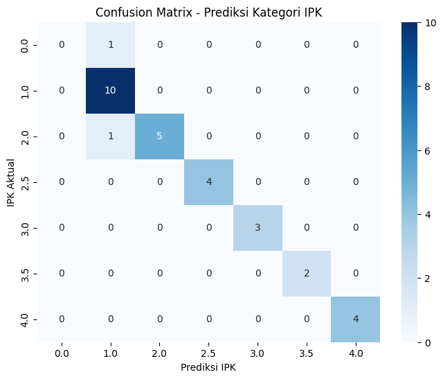
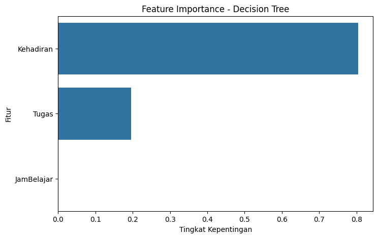
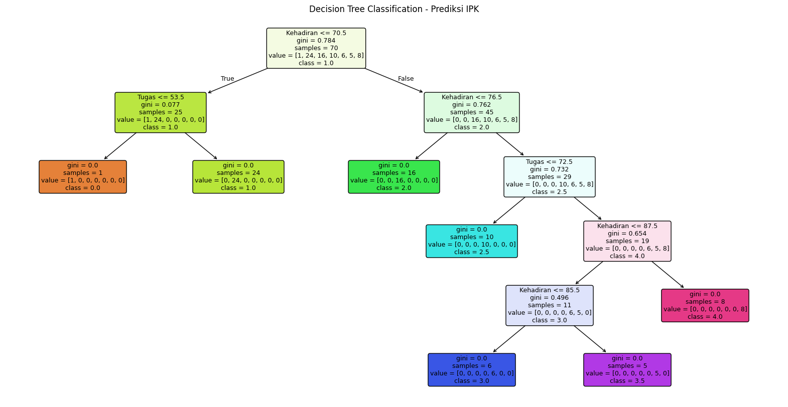

# 🎓 IPK Classification Using Decision Tree

A Machine Learning project to classify student GPA (IPK) categories using the **Decision Tree algorithm**, evaluated with **Recall and F1-Score**.

## 📌 Project Overview

This project applies a Decision Tree Classifier to predict student GPA categories based on academic performance indicators.

## 🎯 Objectives

- Build a classification model using Decision Tree.
- Predict student GPA categories.
- Evaluate model performance using Recall and F1-Score.
- Visualize classification results and model characteristics.

## 🛠️ Technologies & Libraries

- Python
- Pandas
- Scikit-learn
- Matplotlib
- Seaborn

## 📂 Dataset

| Feature | Description |
|---|---|
| JamBelajar | Study hours |
| Kehadiran | Attendance |
| Tugas | Assignment score |
| IPK | GPA category (target) |

## ⚙️ Methodology

1. Data Preparation
2. Feature Selection
3. Data Splitting (70% Training, 30% Testing)
4. Decision Tree Model Training
5. GPA Category Prediction
6. Model Evaluation
7. Data Visualization

## 📊 Model Evaluation

The model uses the following evaluation metrics:

- **Recall (Macro):** Measures the model's ability to identify each GPA category.
- **F1-Score (Macro):** Measures the balance between Precision and Recall across all categories.

## 📈 Results & Visualizations

The following visualizations are generated from the classification model.

### 1. Confusion Matrix

Displays the comparison between actual and predicted GPA categories.



### 2. Feature Importance

Shows the relative importance of each feature used by the Decision Tree model.



### 3. Decision Tree Visualization

Displays the decision-making structure of the trained classification model.



### 4. Evaluation Report

The detailed evaluation results, including Recall, F1-Score, Precision, and classification metrics, are available here:

[View Evaluation Report](outputs/hasil_evaluasi.txt)

## 📁 Project Structure

```text
ipk-classification-recall-f1score/
│
├── dataset/
│   └── Hasil_IPK_Final.csv
│
├── output/
│   ├── confusion_matrix.png
│   ├── feature_importance.png
│   ├── decision_tree.png
│   └── hasil_evaluasi.txt
│
├── main.py
├── requirements.txt
└── README.md
```

## 🚀 How to Run

1. Clone this repository:

   ```bash
   git clone https://github.com/annorism/ipk-classification-recall-f1score.git
   ```

2. Install dependencies:

   ```bash
   pip install -r requirements.txt
   ```

3. Run the project:

   ```bash
   python main.py
   ```

## 👩‍💻 Author

**annorism**

GitHub: [@annorism](https://github.com/annorism)
